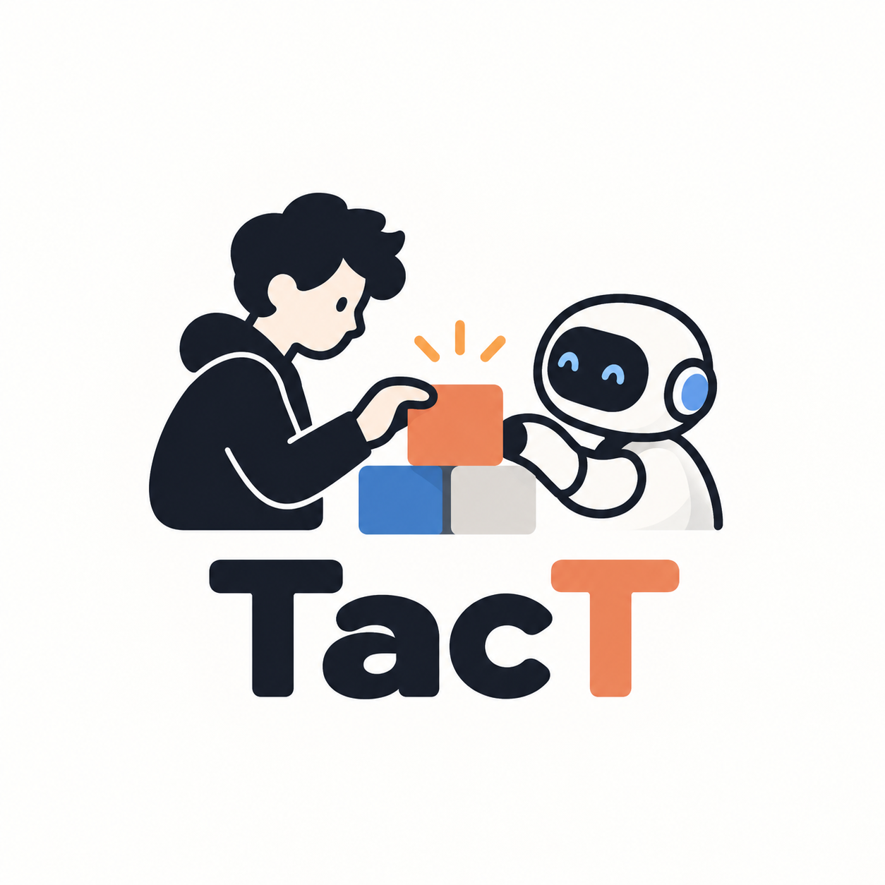

# TacT Agent Kit

TacT takes its name from *tact*: a sense of proportion and consideration in how people work together. This Agent Kit offers engineering guidance for developers working with agents: better delivery, useful judgment, and interaction that helps the developer observe, learn, and guide important choices.

Start with [the adoption guide](core/README.md) and [developer–agent collaboration](core/collaboration.md). The shared distribution unit is [AGENTS.md](AGENTS.md) plus `core/`; the adopting project owns `project/`.

The [migration record](docs/migration.md) identifies the complete authoring source, the corrected migration, scoped verification, and remaining trial work. The [English baseline](docs/baseline/AGENTS.en.md) is preserved for comparison and fallback. Source repository: [MerlinSMQWQ/TacT](https://github.com/MerlinSMQWQ/TacT); use the Git commit of the copied version when adopting it.
